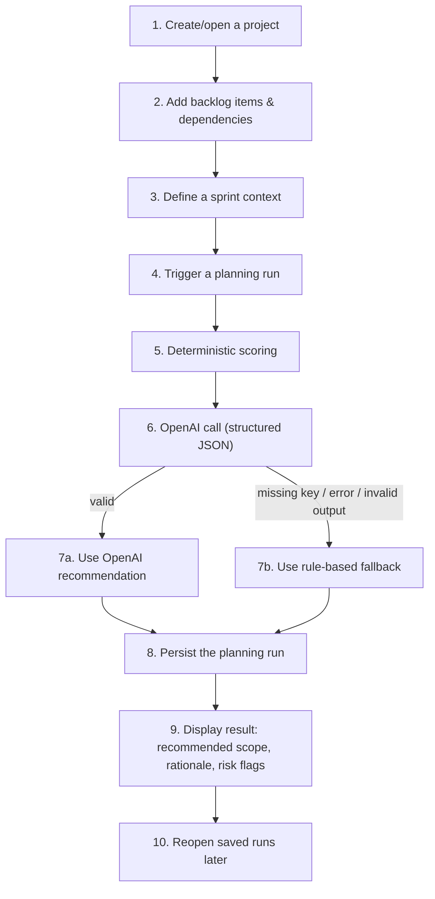

# Prototype walkthrough

A thesis-ready walkthrough of the prototype's main workflow, mapping each
step of the intended workflow (see
[`docs/architecture-spec.md`](./architecture-spec.md)) to the actual
screens, routes, and code in this repository. Intended for a supervisor
or evaluator who wants to understand what the system does and where to
look in the codebase, without needing to read the full source.

For hands-on setup and demo steps, see
[`local-demo-guide.md`](./local-demo-guide.md). For details on the
predefined demo projects referenced below, see
[`evaluation-scenarios.md`](./evaluation-scenarios.md).

## Workflow overview

## Step-by-step

### 1-2. Create a project and manage its backlog

- **Screen:** dashboard (`/`) to create a project; project detail page
  (`/projects/[id]`) for the backlog workspace.
- **Code:** [`app/page.tsx`](../app/page.tsx),
  [`app/projects/[id]/page.tsx`](../app/projects/%5Bid%5D/page.tsx),
  [`components/backlog-workspace.tsx`](../components/backlog-workspace.tsx),
  `lib/projects/`, `lib/backlog/`, `lib/dependencies/`.
- Backlog items have a type, priority, story points, and status.
  Dependencies are directed ("item A depends on item B" - A is blocked
  until B is done).

### 3. Define a sprint context

- **Screen:** "Sprint planning" section of the project page.
- **Code:**
  [`components/sprint-planning-workspace.tsx`](../components/sprint-planning-workspace.tsx),
  `lib/sprint-contexts/`.
- Captures the sprint goal, team capacity (in story points), available
  days, and team size.

### 4-8. Trigger planning, scoring, the AI call, and the fallback

- **Trigger:** the "Run planning" button in the Sprint planning section
  calls `POST /api/projects/[id]/plan`
  ([`app/api/projects/[id]/plan/route.ts`](../app/api/projects/%5Bid%5D/plan/route.ts)).
- **Orchestration:**
  [`lib/planning/orchestrator.ts`](../lib/planning/orchestrator.ts)
  coordinates the whole pipeline:
  1. **Deterministic scoring** ([`lib/planning/scoring.ts`](../lib/planning/scoring.ts)) -
     ranks backlog items by priority, readiness, and dependency
     penalties. This always runs and is also the fallback baseline.
  2. **Prompt payload construction**
     ([`lib/planning/prompt-builder.ts`](../lib/planning/prompt-builder.ts)) -
     builds a structured JSON payload from the project, sprint context,
     and scored candidate items.
  3. **OpenAI call** - sends the payload to the OpenAI API and requires
     a structured JSON response containing only the recommendation
     decision (which item ids to recommend/exclude, a rationale, and
     risk flags) - not a re-derivation of scores or item data.
  4. **Validation** ([`lib/planning/validators.ts`](../lib/planning/validators.ts)) -
     the model's JSON is parsed and checked against a Zod schema, plus a
     sanity check that every candidate item id is assigned exactly once
     (no hallucinated or missing ids).
  5. **Fallback** - if the API key is missing, the request fails, or
     validation fails for any reason, the deterministic recommendation
     computed in step 1 is used instead. This never throws - a result is
     always produced.
- **Result source is explicit:** the final result's `generatedBy` field
  is either `"openai-v1"` or `"rule-based-v1-fallback"`, so it is always
  clear which path produced a given recommendation - useful for
  thesis evaluation of the AI's actual contribution.

### 9. Display the result

- **Screen:** the result renders inline on the project page immediately
  after a run, via
  [`components/planning-result-view.tsx`](../components/planning-result-view.tsx) -
  showing the recommended sprint scope, the full prioritized ranking,
  excluded items (with why, e.g. "blocked by ..."), the rationale
  summary, and risk flags.

### 10. Persist and reopen saved runs

- Every run is persisted as a `PlanningRun` row
  (`lib/planning-runs/`), regardless of whether it came from OpenAI or
  the fallback.
- **Screens:** the "Saved planning runs" list on the project page links
  to a standalone detail page at `/runs/[id]`
  ([`app/runs/[id]/page.tsx`](../app/runs/%5Bid%5D/page.tsx)), which
  renders the exact same result view for a previously saved run.

## What to look at when evaluating usability

- Whether the workflow above (project → backlog → sprint context → run
  → result → reopen) is understandable without prior explanation.
- Whether the rationale and risk flags make the recommendation's
  reasoning clear (this is the main explainability mechanism - there is
  no separate "why" chat interface by design).
- Whether the deterministic fallback (visible via `generatedBy:
"rule-based-v1-fallback"`) still produces a sensible, usable result
  when compared to an OpenAI-generated one (`generatedBy: "openai-v1"`)
  for the same scenario - this is the basis for comparing rule-based vs.
  AI-assisted recommendations in the thesis.

## Explicitly out of scope for this prototype

Kept out to stay within thesis MVP scope (see
[`docs/copilot-master-prompt.md`](./copilot-master-prompt.md) and
[`docs/architecture-spec.md`](./architecture-spec.md)):

- authentication / multi-user support
- manual override or editing of a recommendation after generation
- run comparison dashboards or analytics/charts
- chat-style interaction, streaming responses, or conversation history
- RAG, a vector database, or any heavy AI orchestration framework
