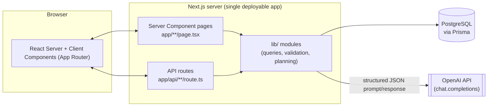
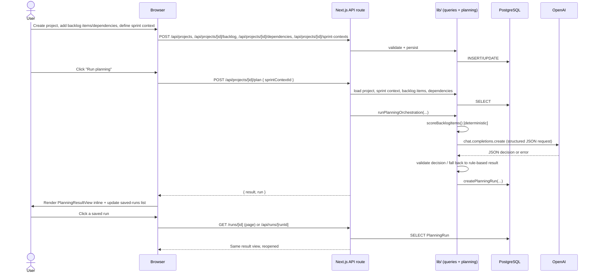

# System architecture

Technical description of the implemented architecture of the Generative
AI Sprint Planning Assistant prototype. This document describes what is
actually built in this repository - see
[`docs/copilot-master-prompt.md`](./copilot-master-prompt.md) and
[`docs/architecture-spec.md`](./architecture-spec.md) for the original
target design this implementation follows.

## System purpose

A workflow-based (not chatbot-first) web application that helps a Scrum
team plan a sprint: it takes a project's backlog, dependencies, and
sprint context (goal, capacity, team size), computes a deterministic
priority ranking, optionally asks an LLM (OpenAI) to decide a recommended
sprint scope from that ranking, and persists the result so it can be
reviewed and reopened later. It is a master's-thesis MVP, intentionally
scoped to a single, explainable planning workflow rather than a
general-purpose project management tool.

## Architectural overview

There is a single Next.js application - no separate backend service, no
microservices, no message queue, and no vector database. Persistence is
exclusively PostgreSQL through Prisma. The only external network
dependency is the OpenAI API, and it is optional at runtime (see
[Fallback behavior](#fallback-behavior)).

## Major components

### Frontend (Next.js App Router, React, Tailwind CSS)

- Server Components (`app/page.tsx`, `app/projects/[id]/page.tsx`,
  `app/runs/[id]/page.tsx`) fetch data directly from Prisma via `lib/`
  query modules and render initial HTML - no separate client-side data
  fetching layer or state management library.
- Client Components (`components/*.tsx`, all marked `"use client"`
  except the purely presentational `planning-result-view.tsx` and
  `evaluation-scenario-badge.tsx`) handle forms and interactive lists
  (project creation, backlog CRUD, dependency management, sprint context
  CRUD, triggering a planning run) by calling the API routes with
  `fetch` and refreshing the Server Component tree via
  `router.refresh()`.

### Backend / application layer (Next.js API routes)

- REST-style route handlers under `app/api/`, one `route.ts` per
  resource, each performing: input validation (Zod), a lookup of the
  parent resource (404 if missing), the actual operation, and a JSON
  response - see [Implementation summary](./implementation-summary.md)
  for the full route list.
- No authentication/authorization layer - the prototype is intended to
  be run locally or in a single-tenant demo deployment.

### Planning orchestration layer (`lib/planning/`)

The core "AI feature" of the system, implemented as a small, custom
module set (no LangChain/LlamaIndex/agent framework):

- `scoring.ts` - deterministic, rule-based candidate ranking.
- `prompt-builder.ts` - builds the structured JSON payload sent to the
  model.
- `validators.ts` - Zod schemas for planning request input, the AI
  decision shape, and the final result contract.
- `orchestrator.ts` - coordinates scoring, prompt building, the OpenAI
  call, output validation, and fallback selection.

### Persistence layer (`lib/prisma.ts`, `prisma/schema.prisma`)

PostgreSQL accessed exclusively through Prisma ORM (v7, driver adapters
via `@prisma/adapter-pg`). See [Database models](./implementation-summary.md#database-models)
in the implementation summary for the full schema.

### Evaluation/demo support (`lib/evaluation-scenarios/`, `prisma/seed.ts`)

A thin layer that labels specific seeded projects as reproducible demo
scenarios for thesis evaluation - see
[`evaluation-support.md`](./evaluation-support.md).

## Data flow

## Planning orchestration flow

Implemented in `lib/planning/orchestrator.ts`, `runPlanningOrchestration`
(async) performs, in order:

1. **Deterministic scoring** (`scoreBacklogItems`) - ranks active
   (non-`DONE`) backlog items using a weighted sum of priority, status
   readiness, and a fixed penalty for items blocked by an unfinished
   dependency. This is always computed and serves as both the baseline
   ranking shown to the user (`prioritizedItems`) and the fallback
   recommendation.
2. **Prompt payload construction** (`buildPlanningPromptPayload`) -
   assembles a structured JSON object (project, sprint context,
   candidate items with their scores/status/blocked state) - no
   free-text prompt templating beyond a fixed instruction string.
3. **OpenAI call** (`callOpenAiForPlanningDecision`) - sends the payload
   as the user message to `chat.completions.create` with
   `response_format: { type: "json_object" }` and a system prompt
   requiring a narrow JSON decision: `recommendedItemIds`,
   `excludedItemIds`, `rationaleSummary`, `riskFlags`. The model is
   deliberately not asked to reproduce scores or item metadata, to avoid
   hallucination.
4. **Output validation** - the raw JSON is parsed and checked with
   `aiPlanningDecisionSchema` (Zod), then sanity-checked with
   `isAiDecisionConsistentWithCandidates` (every candidate item id must
   be assigned to exactly one of recommended/excluded, no invented or
   duplicate ids).
5. **Fallback selection** - if the AI decision is missing or fails
   either check, the deterministic rule-based recommendation from step 1
   is used instead. Otherwise, the AI decision is mapped back onto the
   real `ScoredBacklogItem` objects.
6. **Result assembly and validation** - the final object (shared shape
   regardless of source) is validated against `planningResultSchema`
   before being returned.
7. **Persistence** - the API route (`app/api/projects/[id]/plan/route.ts`)
   persists the validated result as a `PlanningRun` row.

## Fallback behavior

The system never fails a planning request due to the AI call. Every
failure mode returns `null` from `callOpenAiForPlanningDecision` (logged
via `console.warn`/`console.error`, never thrown) and the deterministic
result is used instead:

| Failure mode                                                             | Behavior                                    |
| ------------------------------------------------------------------------ | ------------------------------------------- |
| `OPENAI_API_KEY` not set                                                 | Skips the API call entirely, logs a warning |
| OpenAI request fails (network, auth, rate limit)                         | Catches the error, logs it                  |
| Response has no content                                                  | Logs an error                               |
| Response is not valid JSON                                               | Logs a JSON-parse error                     |
| Response fails `aiPlanningDecisionSchema`                                | Logs the Zod validation error               |
| Response is valid JSON but references unknown/duplicate/missing item ids | Fails the consistency check                 |

The result's `generatedBy` field makes the actual source explicit:
`"openai-v1"` or `"rule-based-v1-fallback"` - this is the mechanism used
to compare AI-assisted vs. deterministic recommendations during
evaluation.

## Deployment overview

- Single Next.js application (App Router, Turbopack build), deployable
  as one process/container - no separate services to orchestrate.
- Requires a reachable PostgreSQL instance (`DATABASE_URL`) and,
  optionally, `OPENAI_API_KEY` / `OPENAI_MODEL` for AI-assisted
  planning.
- No background workers, queues, or scheduled jobs - all work happens
  synchronously within a single request/response cycle.
- Prisma migrations (`prisma/migrations/`) and the seed script
  (`prisma/seed.ts`) are the only database setup steps required; see
  [`local-demo-guide.md`](./local-demo-guide.md).

## Out-of-scope items

Deliberately not built, to keep the prototype within thesis MVP scope:

- Authentication, authorization, or multi-tenant access control.
- RAG, a vector database, or any embeddings-based retrieval.
- LangChain, LlamaIndex, Semantic Kernel, or any agent/orchestration
  framework beyond the custom `lib/planning/` modules.
- Streaming model responses, a chat interface, or conversation/prompt
  history.
- Manual editing/overriding of a generated recommendation.
- Run comparison dashboards, analytics, or charts.
- Background jobs, queues, or caching layers (e.g. Redis).
- User tracking, telemetry, or in-app survey/feedback tooling.
